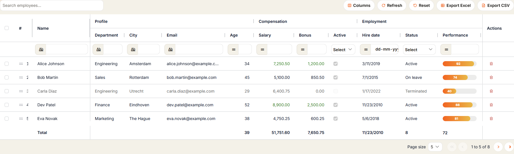
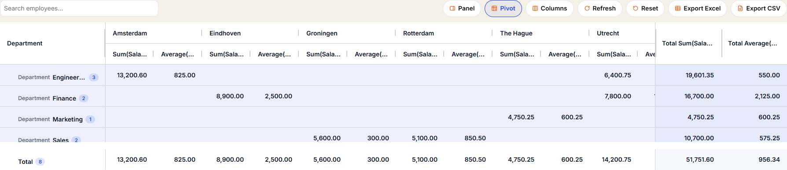
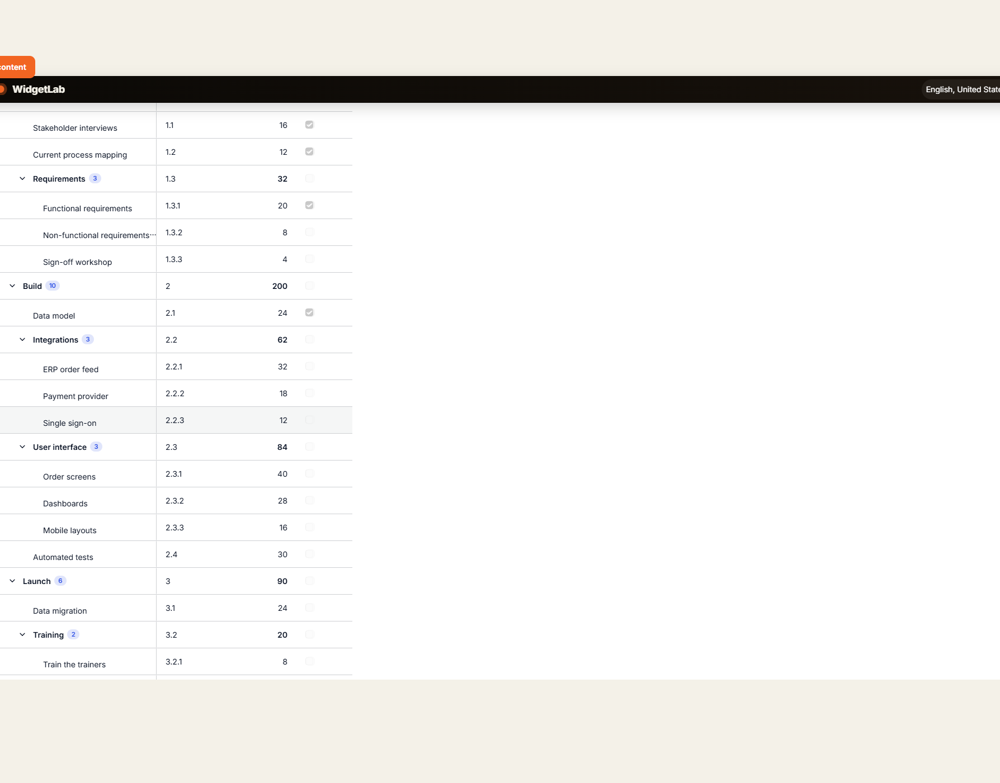
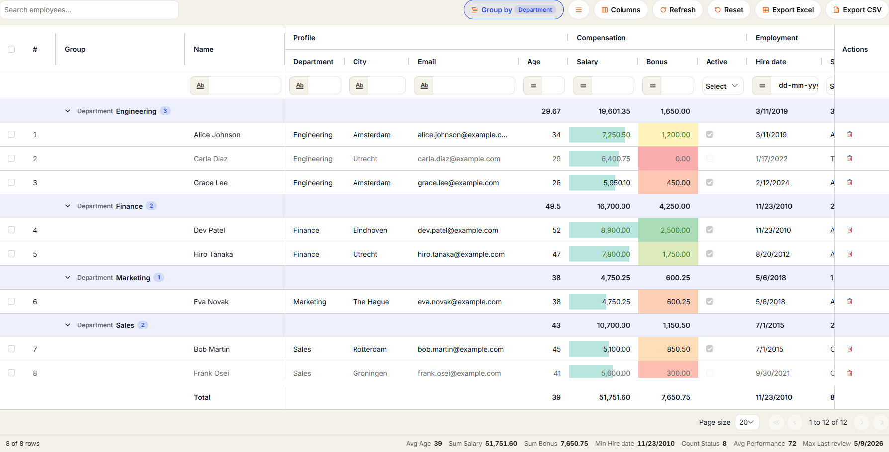
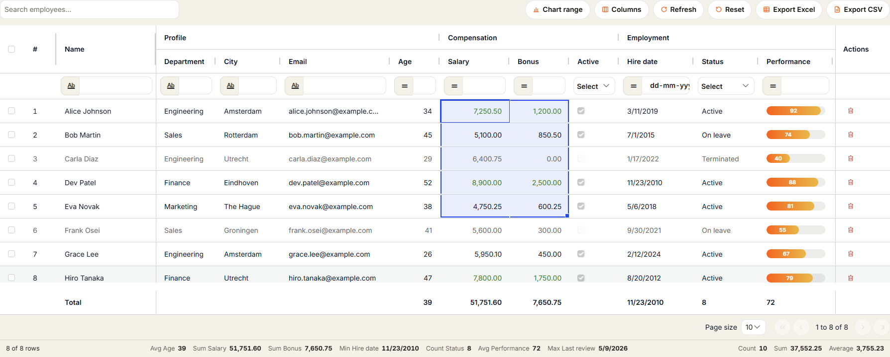
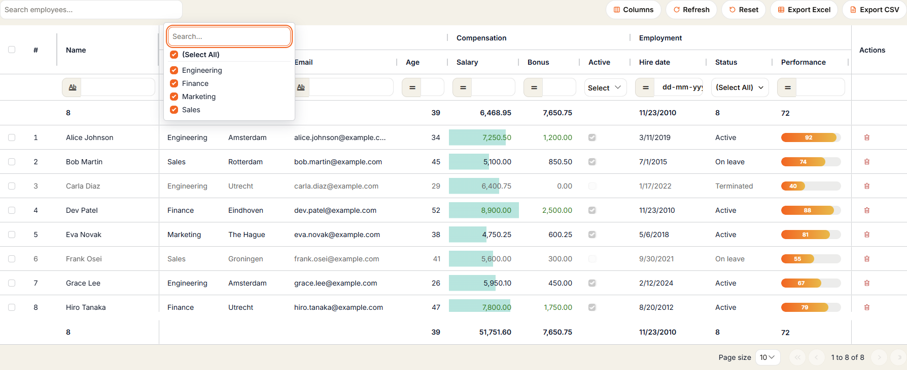
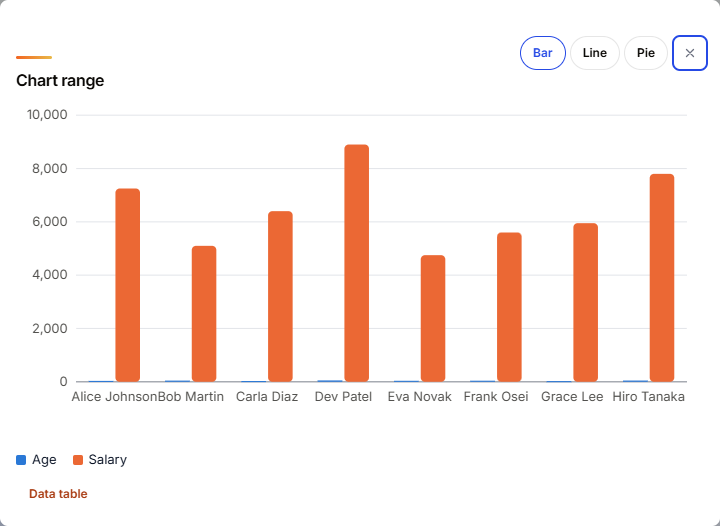

# AG Grid Demo for Mendix

> Example Mendix module for [AG Grid for Mendix](https://github.com/bharathidas/AGGrid) (the AGGrid pluggable widget). One page with 18 working grid examples: editable data grid, pivot table, tree grid, row grouping, Excel-like cell ranges, set filters, saved views, server-side data and Excel export.



- Mendix 11.0 or newer, web and responsive apps
- Module name: `AGGridDemo`, version 1.1.0
- License: Apache-2.0
- Includes the AGGrid widget 1.1.0 (`com.mxtechies.widget.web.AGGrid.mpk`)
- Widget docs and site: https://bharathidas.github.io/AGGrid/

## Install in 4 steps

1. Download `AGGridDemo.mpk` from the [latest release](https://github.com/bharathidas/AGGridDemo/releases/latest) or the Mendix Marketplace.
2. In Studio Pro choose **App > Import module package** and pick the file. The AGGrid widget comes with it.
3. Under **App > Security > User roles**, add the module role `AGGridDemo.User` to your user roles.
4. Add the page `AGGridDemo.AgGrid_Test` to your navigation, run the app, open the page and click **Seed sample data** once.

Upgrading from the 1.0.0 demo: import the package and let Studio Pro replace the existing `AGGridDemo` module, then run **Seed sample data** and **Seed task tree** once.

## The 18 examples

| # | Example | What it shows |
| --- | --- | --- |
| 1 | AG Grid | Header groups, floating filters, quick search, inline editing with an On commit microflow, multi selection, row drag, pinned columns, progress bar column, totals row, Excel and CSV export, paging |
| 2 | Server data loading | Paging, sorting and filtering done by the data source, like Data Grid 2 |
| 3 | Events, layout memory and theming | Every event runs a microflow; layout remembered in the browser; Quartz theme with an accent colour |
| 4 | Bare grid | Every toolbar and selection option off; Alpine dark, print layout, auto refresh |
| 5 | Balham and Material themes | The same data in two AG Grid themes |
| 6 | Totals from a microflow | Server grid totals computed by `DS_AgGridTotals` |
| 7 | Search from another widget | A text box drives quick search; the column layout is saved as JSON in an attribute |
| 8 | Keep in client, save per row | Save button per row, On change per column, link, image and badge columns |
| 9 | Single selection and live row drag | Rows move while you drag; the order is written to `SortOrder` |
| 10 | Saved views, detail rows, cell checks | Named views, expandable detail rows, validation with an Issues badge, keyboard help |
| 11 | Row grouping and conditional formats | Group by, data bars, colour scales, icon sets, sparklines, status bar, paste from Excel |
| 12 | Collapsed groups | Two grouping levels, grouped columns hidden, Lower is better data bars |
| 13 | Pivot table | Departments by city, summed salary and averaged bonus, subtotals and a grand total, side panel |
| 14 | Tree data | A work breakdown from a self reference (`AgGridTask_Parent`) with summed estimates |
| 15 | Cell ranges, fill handle and chart | Excel-like range selection, fill series, bar, line and pie charts |
| 16 | Set filter, totals and styled Excel | Checkbox filters, totals at the top and bottom, styled .xlsx with SUBTOTAL formulas |
| 17 | Side panel, grouping and saved views | Columns and Filters tabs, drag columns into row groups |
| 18 | Lazy server-side groups | Group counts from the server, rows loaded per group; add 500 employees to try it at volume |

## What is inside the module

| Document | Purpose |
| --- | --- |
| Entity `AgGridEmployee` | Sample employees: Name, Department, City, Email, Age, Salary, Bonus, Active, HireDate, Status, Performance, LastReview, SortOrder, Notes, Trend, Comments, Audit, CreditCheck |
| Entity `AgGridTask` | Work breakdown for the tree example: Code, Name, Estimate, Done, parent over `AgGridTask_Parent` |
| Entity `AgGridTotals` | Non-persistent totals returned by `DS_AgGridTotals` |
| Entity `AgGridContext` | Non-persistent helper: SearchText and GridLayout for example 7 |
| Enumeration `AgGridStatus` | Active, On leave, Terminated |
| Microflows `ACT_AgGridEmployee_Seed`, `ACT_AgGridTask_Seed` | Create the sample employees and the task tree |
| Microflows `ACT_AgGridEmployee_SeedMany`, `ACT_AgGridEmployee_RemoveMany` | Add and remove 500 employees for the server examples |
| Microflow `ACT_AgGridEmployee_OnCommit` | On commit action: writes "Committed &lt;attribute&gt;: &lt;old&gt; -> &lt;new&gt;" into Notes and commits |
| Microflows `ACT_Feature_Event`, `ACT_Feature_Log`, `ACT_Feature_Count` | Show which grid event fired and with what values |
| Microflows `DS_AgGridTotals`, `DS_AgGridContext`, `ACT_AgGrid_AddInvalidEmployee` | Data sources and helpers for examples 6, 7 and 10 |
| Page `AgGrid_Test` | The 18 examples |
| Page `AgGridEmployee_NewEdit` | Popup form for one employee |
| Module role `User` | Read and write access to the demo entities |

## Screenshots

| | |
| --- | --- |
|  |  |
|  |  |
|  |  |

## Repository layout

```
releases/AGGridDemo.mpk    module package exported with Studio Pro 11.12.1
themesource/aggriddemo/    module styling (empty; the page uses the widget defaults)
docs/                      screenshots used here and in the Marketplace listing
```

## Development

The module lives in the app that also builds the widget. Open that app in Studio Pro 11.12.1, change the module and export it with **right-click the module > Export module package** (or `mx create-module-package <app.mpr> AGGridDemo`).
