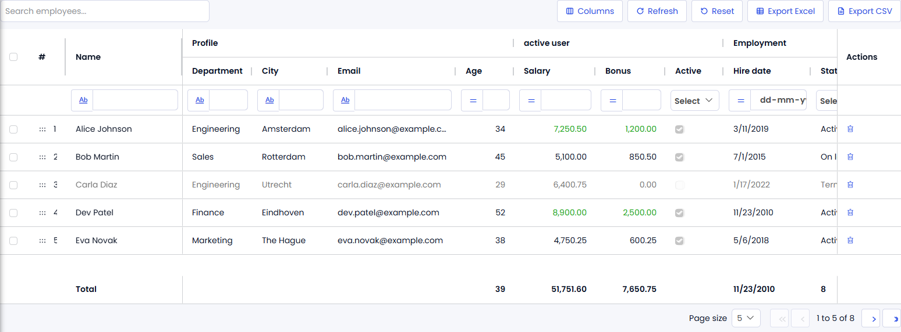

# AGGrid Demo

> Example Mendix module for the [AGGrid](https://github.com/bharathidas/AGGrid) pluggable widget: an employee list that shows every feature of the grid on one page.



- Mendix 11.0 or newer, web only
- Module name: `AGGridDemo`
- License: Apache-2.0
- Requires the AGGrid widget (`com.mxtechies.widget.web.AGGrid.mpk`, version 1.0.0 or newer)

## What is inside

| Document | Purpose |
| --- | --- |
| Entity `AgGridEmployee` | Name, Department, City, Email, Age, Salary, Bonus, Active, HireDate, Status (enumeration), Performance, LastReview, SortOrder and Notes |
| Enumeration `AgGridStatus` | Active, OnLeave, Terminated |
| Microflow `ACT_AgGridEmployee_Seed` | Deletes and recreates eight sample employees |
| Microflow `ACT_AgGridEmployee_OnCommit` | The On commit action: writes "Committed &lt;attribute&gt;: &lt;old&gt; -> &lt;new&gt;" into Notes and commits |
| Page `AgGrid_Test` | Two AGGrid widgets: `agGrid1` in Browser data loading with every feature enabled, and `agGridServer` in Server data loading, plus a Data Grid 2 for comparison |
| Page `AgGridEmployee_NewEdit` | Popup used by the Data Grid 2 New and Edit buttons |
| Module role `User` | Read and write access to the entity |

The `agGrid1` grid demonstrates header groups (Profile, Employment), floating filters, quick search, multi selection with a counter, inline editing with the On commit action, row drag with the SortOrder attribute, pinned Name and Actions columns, a Performance column rendered as a progress bar, a dynamic text column, a custom content column with a Delete button, a totals row (sum, average, minimum, maximum, count), Excel and CSV export and the Atlas paging bar.

## Installation

1. Import the AGGrid widget into your app (Marketplace or the `.mpk` from the widget's releases page) and press F4.
2. Import this module: download `AGGridDemo.mpk` from the [latest release](https://github.com/bharathidas/AGGridDemo/releases) (or the Mendix Marketplace) and use **App > Import module package** in Studio Pro.
3. Map the module role `AGGridDemo.User` to your user roles under **App > Security > User roles**.
4. Add the page `AgGridDemo.AgGrid_Test` to your navigation, run the app, open the page and click **Seed sample data** once.

## Repository layout

```
releases/AGGridDemo.mpk            module package exported from Studio Pro 11.12.1
themesource/aggriddemo/            module styling (empty; the page uses the widget defaults)
docs/                              screenshots used in this README and the Marketplace listing
```

## Development

The module lives in the app that also builds the widget. Open that app in Studio Pro 11.12.1, change the module and export it again with **right-click the module > Export module package**.
